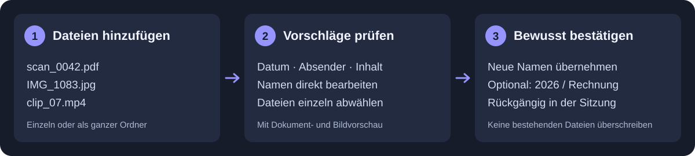

# Nomi

### Every file deserves a name.

Turn `scan_0042.pdf`, `IMG_1083.jpg` and `clip_07.mp4` into names you can recognize.
Nomi reads documents, describes images and samples video scenes to suggest useful
file names. Review the proposals, edit anything you want, and confirm the changes.

[**Download Nomi for Windows and macOS →**](https://github.com/mbosch81/nomi/releases/latest)
· [Get started](docs/START.md) · [Questions and answers](docs/FAQ.md)

Free and open source · Local AI · No cloud account required

> **No installer:** a single EXE for Windows and an app ZIP for Apple Silicon Macs.
> Version 0.12.0 includes German/English interfaces, native Windows OCR and safe
> local folder organization on Windows and macOS.
> [Check download requirements](docs/DOWNLOAD.md).

## Find your files again

- Name invoices, letters and contracts using their date, sender or document type.
- Describe photos and videos, even when they contain no text.
- Import files or folders, optionally including subfolders.
- Edit proposals, adjust table columns and deselect files before making changes.
- Choose your own naming templates and optional destination folders.
- Review changes before confirming. Existing files are never overwritten.
- Undo changes during the current session.

## How it works

1. Open Nomi and add files or drag in a folder.
2. Click **Analyze selected**. Nomi downloads a suitable local model when needed.
3. Check the proposed names alongside the file preview.
4. Click **Rename selected**, review the complete plan, then confirm.

Use the gear button for settings: language, naming rules, AI, images, video frame
count, OCR, a watched inbox folder and optional organization. Language changes
apply after restarting Nomi. The watched folder imports files; it never renames
or analyzes them automatically.

## Your files, your choice

Local analysis runs on your computer using the included llama.cpp runtime. Model
weights are downloaded separately from Hugging Face. Once downloaded, local
analysis needs no network connection. You can also connect Nomi to an existing
Ollama server; document excerpts and image/video samples are then sent to that
configured server. Check any upstream router's privacy settings.

Supported inputs: text and scanned PDFs, DOCX, TXT, Markdown, CSV, PNG, JPEG and
common video containers. Video analysis samples frames; it does not transcribe
sound. OCR uses Apple Vision on macOS and the Windows OCR engine on Windows. Available recognition languages depend on your operating
system. Tesseract is optional. FFmpeg is included.

## Learn more

[Downloads](docs/DOWNLOAD.md) · [Getting started](docs/START.md) ·
[Settings](docs/SETTINGS.md) · [FAQ](docs/FAQ.md) · [Changelog](CHANGELOG.md) ·
[Development](docs/DEVELOPMENT.md) · [Third-party notices](docs/THIRD_PARTY.md)

Nomi is licensed under [MIT](LICENSE). AI proposals can be wrong: review names and
try copies of your files first.
